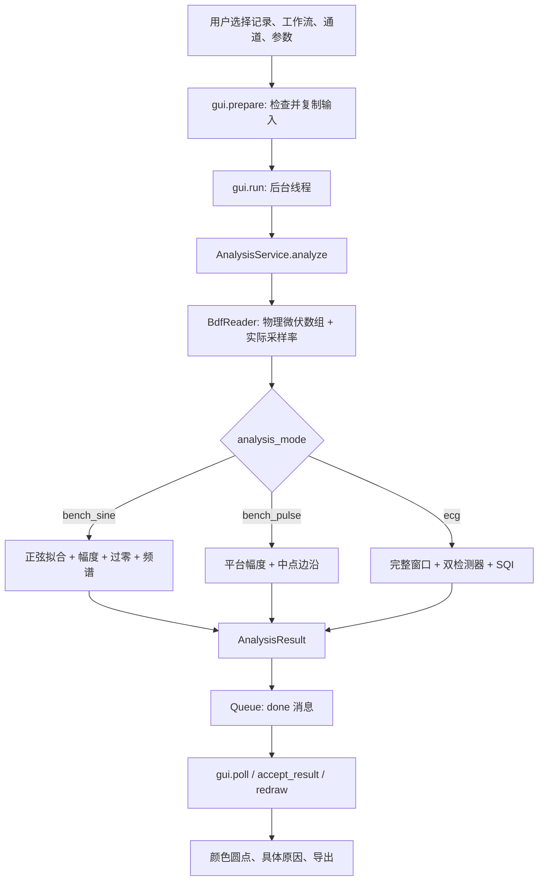

# Electrode QA：从界面到算法，逐步理解代码

更新：2026-09-30。应用界面、自动生成的解释和报告均为英文；本文件用中文讲解。

## 1. 先理解两个阶段

Stage 1 是已知输入的台架验证：发生器 → 电极/盐水桶 → BioSemi → BDF。输入已知，才可以比较输出是否正确。

Stage 2 是 ECG 质量筛查：每个通道、每个时间窗口，判断记录是否需要检查。此时通常没有一个已知“正确输入幅度”。

这次实现三条明确的路径：

| Analysis workflow | 程序内部值 | 输入 | 输出 |
|---|---|---|---|
| Stage 1 - Bench / Sine | bench_sine | 已知正弦 | gain、linearity、双向过零、repetition、SNR、SINAD、THD、frequency |
| Stage 1 - Bench / Pulse | bench_pulse | 两平台脉冲 | gain、linearity、双向中点边沿、repetition、frequency |
| Stage 2 - ECG quality | ecg | ECG 或用于开发的模拟 ECG | bSQI、pSQI、kSQI、basSQI、flatline/clipping，逐窗口结果 |

Pulse 不经过正弦拟合。ECG 不经过正弦拟合，也不拿所有电极的 R 峰时间差来判 ECG 质量。
文件名中的 T1/T2 是实验编号，不能直接等同于 Stage 1/2。

## 2. 在 VS Code 中怎么运行

打开 `Electrode-QA.code-workspace`，选择安装了 numpy、scipy、matplotlib 的 Python，再打开 `gui.py` 按 F5，或在本项目终端执行：

```powershell
python gui.py
```

第一次熟悉界面建议：

1. `Analysis workflow` 选 `Stage 2 - ECG quality`。
2. Count 填 8，点 Demo。这是合成数据，不是实验结论。
3. Metric 选 ECG quality、Baseline、Flatline 等，分别观察。
4. Result scope 选 Window 中的 0–10 s、5–15 s 等，观察相同电极在不同时间的状态。
5. 点击圆点，阅读原因和数值。
6. 切回 `Stage 1 - Bench / Sine`，保持勾选 `Build time windows`，点 Demo。这会生成 30 秒合成数据，EXG2 在 10–20 秒幅度下降 50%；选择 `Gain error`，拖动滑块观察变化。
7. 要演示 Linearity、Repetition，先取消 `Build time windows` 再点 Demo，载入原来的多幅度、多次重复数据；选择 Analyze = All loaded records，重新运行，然后把 Result scope 切到 All analyzed records / worst case。

默认 Analyze = Selected record，只分析左侧选中的一个 BDF；不会因为加载 ZIP 就自动把全部记录合并。批量运行后，点击左侧不同文件，会切换到那份文件的结果。未经分析的文件会清除旧图，并要求重新运行。

Vpp 确认是逐文件保存的：勾选框的 THIS record 指当前文件。Apply record 保存到该文件，Run analysis 也会自动应用当前编辑；列表的 Verified 列显示 Yes/No。勾选 Test 1 不会顺便确认 Test 2。整批汇总提示会标明来源文件。Save project 始终保存全部已加载记录。

四个 `Latest lab presets` 会读取原始 ZIP，无需手动解压：

- 10 electrodes - Sine：A1–A10。
- 128 electrodes - Sine：A1–D32。
- 128 electrodes - Pulse：A1–D32。
- 10 electrodes - ECG：A1–A10。

这些是按照实验文件夹名称和截图建立的通道预选，仍需你核对实际接线。137 个已保存通道不等于 137 个被测电极。Status 不会参与 heatmap。

## 3. 为什么分成很多 class

每个 class 负责一种清晰的工作。与 ENGG3112 的功能拆分思路相同：改一个算法，不必改按钮；改按钮，不必重写算法。

| 文件 | 主要 class / function | 工作 |
|---|---|---|
| gui.py | ElectrodeQAApp | 创建控件、读取输入、启动分析、显示结果 |
| config.py | AnalysisSettings | 保存阈值并检查参数是否合法 |
| models.py | InputRecord / MetricResult / ElectrodeResult / AnalysisResult | 定义数据在模块之间如何传递 |
| utils/input_catalog.py | records_from_paths | 从 BDF/ZIP 建立记录清单，识别文件名提示 |
| utils/bdf_reader.py | BdfReader | 检查文件头，选择真实通道，读取 BDF |
| utils/array_store.py | ArrayStore | 小数组放内存，大数组使用临时磁盘映射；完成后清理 |
| utils/centered_channels.py | CenteredChannels | 做过零检测时才生成当前电极的去基线样本 |
| utils/numerics.py | read_bdf_stream / fit_record | 24-bit 解码、单位换算、正弦最小二乘拟合 |
| services/analysis_service.py | AnalysisService | 按工作流选择算法并汇总结果 |
| modules/sine_fitter.py | SineFitter | 正弦幅度、频率、基线、残差 |
| modules/gain_error.py | AmplitudePeakGainError | 输入输出幅度比较 |
| modules/linearity.py | LinearityAnalyzer | 多幅度线性度 |
| modules/time_synchronization.py | ZeroCrossingDetector / TimeSynchronizationAnalyzer | 两种方向事件检测与配对 |
| modules/repeatability.py | RepeatabilityAnalyzer | 独立重复实验的 CV 和延迟 SD |
| modules/bench_spectrum.py | BenchSpectrumAnalyzer | SNR、SINAD、THD、频率误差 |
| modules/pulse_analyzer.py | PulseAnalyzer | 两平台幅度、中点边沿所需数据、脉冲频率 |
| modules/ecg_quality.py | EnergyQRSDetector / ProminenceQRSDetector / BeatAgreement / ECGQualityAnalyzer | ECG 检测器与 SQI |
| modules/windowing.py | WindowPlan | 将秒数换成采样索引，生成完整窗口，不拼接文件 |
| views/timeline_view.py | TimelineView | 时间滑块、颜色条、播放暂停和下一个警告窗口 |
| views/heatmap_view.py | HeatmapView / HeatmapRenderer | GUI 圆点和 PNG，不计算信号指标 |
| utils/report_exporter.py | ReportExporter | 导出 JSON、CSV、HTML、PNG |

`self` 表示当前对象。例如 `self.settings` 是这个分析器使用的设置。不同对象可以使用不同设置，因此测试时不需要打开 GUI。

```python
settings = AnalysisSettings(analysis_mode="ecg", ecg_window_s=10)
analyzer = ECGQualityAnalyzer(settings)
metrics = analyzer.analyze_window(samples_uV, fs=1024)
```

这一段体现“算法不依赖界面”。样本来自哪里、按钮长什么样，不影响这个 class 的调用方式。

## 4. 点一次 Run analysis，发生了什么



你应该先阅读这几个函数，而不是从 gui.py 第一行一直往下读：

1. `ElectrodeQAApp.prepare()`：读取输入、校验、创建分析请求。
2. `ElectrodeQAApp.run()`：创建后台线程。
3. `AnalysisService.analyze()`：决定走哪个算法。
4. `AnalysisService._analyze_ecg()`：如果是 ECG，怎样分窗口。
5. `ElectrodeQAApp.poll()`：把后台结果交回界面。
6. `ElectrodeQAApp.redraw()`：把指标颜色画出来。

`_build()`、`_build_records()`、`_build_results()`、`_build_criteria()` 主要是控件布局，不是信号算法。

## 5. 三种最重要的数据对象

### InputRecord：一份记录是什么

```python
record = InputRecord(
    id="run1",
    path="experiment.bdf",
    frequency_hz=5,
    input_mVpp=100,
    input_confirmed=False,
    waveform="sine",
    setup_group="two_bucket_setup_A",
)
```

`input_confirmed=False` 的含义是“100 只是候选输入值，尚未独立确认”。程序仍能读取、测量和显示数据，但不能给绝对增益合格结论。

`member` 如果不为空，指 ZIP 内的 BDF 成员名；原 ZIP 不会被修改。

`repeat_group` 由你手动给真正独立的重复实验填写。相同文件名设置不自动证明它们独立。

`setup_group` 防止把 10 电极接线与 128 电极接线混起来算线性或重复性。相同组名只是你声明实验条件相同，不是程序验证了物理接线。

### MetricResult：一个指标是什么

```python
MetricResult(
    color="yellow",
    message="Actual input Vpp is unconfirmed; absolute gain cannot be assessed",
    values={"output_mVpp": 98.3, "input_mVpp": 100},
)
```

颜色、原因、数值是三个不同部分：

- `color` 给 heatmap 使用。
- `message` 给人理解为什么变色。
- `values` 给你核算、画图、写报告。

不要只保存颜色而丢掉数值。修改阈值后可能改变颜色，但原始测量值仍有意义。

### AnalysisResult：一次完整分析是什么

包含所有电极汇总、所有记录的逐通道结果、参数、计算耗时，以及 ECG 的 `frames`。
`frames` 保留 record ID、start_s、end_s 和该窗口的每通道指标。

## 6. BDF 怎么变成数组

`BdfReader` 先检查文件头、通道名、样本数和文件长度。读取的数据是：

```text
x.shape = (样本数, 所选电极数)
x[:, 0] = 第一个所选电极的完整波形
fs = BDF 中的实际采样率
```

底层将每三个字节还原成带符号 24-bit 数，再按 BDF 文件头换算成物理单位：

```text
physical = (digital - digital_min)
           * (physical_max - physical_min) / (digital_max - digital_min)
           + physical_min
```

计算模块统一接收微伏 uV。幅度输出再转换成 mVpp。**不要把原始整数直接当微伏，也不要把所有新文件都假设成 16384 Hz。** 当前 Pulse 文件实际为 1024 Hz。

## 7. Stage 1 / Sine 的算法

### 幅度与 gain

拟合模型：

```text
x(t) = a*sin(2*pi*f*t) + b*cos(2*pi*f*t) + c + d*(t-mean(t)) + residual
Aout_pp = 2*sqrt(a*a + b*b)
gain_error_pct = 100*(Aout_pp/Ain_pp - 1)
```

`c` 是直流偏置，`d` 是线性漂移。这两项不能算成正弦幅度。

例如已确认输入 100 mVpp，测到 96 mVpp，gain error = -4%。默认红色限值为 5%，预警比例 0.8，所以 4% 正好进入黄色。
波形残差很大时，先报告测量质量不足，避免把强行拟合的幅度当可靠增益。

### Linearity

至少三个同频率、同接线、输入已确认的幅度等级，拟合：

```text
Aout = k*Ain + b
linearity_pct = 100*max(abs(Aout - fitted_Aout)) / (max(Ain)-min(Ain))
```

输入 50/100/150，输出 45/90/135：非常线性，但增益始终低了 10%。所以 gain 与 linearity 都要保留。

### 双向过零与同步

先从正弦中减去拟合的 DC 和线性漂移，然后分别检测 rising、falling。
这个零点是振荡中心，不是 BDF 原始绝对 0 V。

实际两个采样点夹住零点时线性插值：

```text
t_cross = (n - y[n]/(y[n+1]-y[n])) / fs
delay_ms = (t_channel - t_reference)*1000
```

正值表示该通道较晚。每个参考事件只在自己的 +/-T/4 窗口内寻找同方向事件。
某个窗口没有事件就记 missing；不会把下一周期挪过来补。正弦拟合不会预先平移通道来“消除”待测延迟。

每个方向报告数量、中位延迟、P95(abs(delay))，并报告合并两方向的 jitter SD。
参考通道与自身比较当然是 0，所以 REF 的同步项保持“未独立验证”。

注意：周期信号不能辨认整整一个周期的绝对偏移。精确绝对时序还需要共同触发。
采样间隔大于目标容差时，即使插值给出小数，程序也会提示需要时序校准。

### 频谱：为什么同时有 SNR、SINAD、THD

`BenchSpectrumAnalyzer` 对每通道独立搜索频率，再拟合基频及指定阶数的谐波。默认最高阶数为 5，分析带宽为 100 Hz，并受采样率限制。

```text
SNR   = 10*log10(P_fundamental / P_residual_noise)
THD % = 100*sqrt(P_harmonics / P_fundamental)
SINAD = 10*log10(P_fundamental / (P_harmonics + P_residual_noise))
```

残差噪声是去掉 DC、线性漂移和指定谐波之后，在所声明频带内积分得到的功率。高于已拟合阶数、但落在分析带宽中的谐波仍会留在残差里；修改谐波阶数或带宽会改变结果，因此报告中保存这些参数。

旧正弦拟合残差同时包含失真和噪声，不能直接当成严格的纯噪声 SNR。新实现将指定谐波分开。
SINAD 目前是描述性测量，没有配置验收线，因此其单项视图为黄色；它不参与 Bench summary。

频率误差是 `100*(f_measured/f_input-1)`。它不能代替跨通道时序检测。
按用户设置，THD 容差默认 1%，frequency error 容差默认 0.1%，无需每次输入。这是本项目配置的工程阈值，不是通用电极标准。仍可手动清空，清空后只报告测量值，验收状态为未校准。

## 8. Stage 1 / Pulse 有什么不同

`PulseAnalyzer` 估计高低两个平台的中位数：

```text
Aout_pp = high_level - low_level
edge_level = (high_level + low_level)/2
```

以中点穿越时刻作为事件，再复用同方向事件匹配器。上升边沿和下降边沿分别比较。
Pulse 的频率由多个上升边沿的间隔中位数估计；至少需要四个上升边沿。

它不会因为“不是正弦”被正弦残差门限拒绝。Pulse 输入只允许峰峰值单位；不能套用正弦 RMS 到 Vpp 的换算。
这是两平台脉冲的初步算法：极窄脉冲（约小于 0.5% 占空比）、复杂多级波形、严重振铃需要额外模型，不能直接套用。

## 9. Repetition 到底比较什么

同频率、同名义输入、同接线的独立记录至少三次：

```text
CV = 100 * sample_SD(amplitudes_or_gains) / mean(amplitudes_or_gains)
repeat_delay_SD = SD(每次记录的延迟中位数)
```

实际输入都确认时比较 gain，否则比较记录幅度，后者也包含发生器与装置的变化。
两种方向的跨记录延迟 SD 分开算，再取较大者，避免正负方向相互抵消。
同一个 BDF 中 100 个周期可以描述本次稳定性，但不等于重复做了 100 次实验。

## 10. Stage 2：完整 10 秒窗口

默认 window=10 秒、hop=5 秒：

```text
窗口 1: [0, 10)
窗口 2: [5, 15)
窗口 3: [10, 20)
```

括号表示右端不包含。窗口重叠，它们不是独立实验，也不能把各窗口时长相加当总记录时长。
只有 2 秒的文件不会补零成 10 秒；也不会把来自不同 BDF 的片段拼成一个窗口。
若固定步长没有刚好覆盖文件末尾，程序额外加入一个以文件末尾为终点的完整窗口。例如 21 秒记录、10 秒窗口、5 秒步长，窗口为 0–10、5–15、10–20、11–21 秒；最后一步可以短于设定步长。整个文件短于窗口时，记录为没有完整窗口，不补零。

### bSQI：同一通道、两个算法

`EnergyQRSDetector`：5–18 Hz 带通 → 求导平方 → 100 ms 积分 → 候选峰 → 局部峰细化。

`ProminenceQRSDetector`：5–25 Hz 带通 → 绝对幅度 → prominence/height 检测，不使用前一个算法的候选峰。

二者是不同检测思路，并不意味着统计上完全独立，也没有保证它们不会同时犯错。这里是可解释的开发原型，不是经过临床验证的检测器套件。

`BeatAgreement` 在默认 50 ms 容差内做一对一匹配：

```text
bSQI = matched / (beats_A + beats_B - matched)
```

例如 A 找到 10 个，B 找到 9 个，其中 9 个匹配：bSQI=9/(10+9-9)=0.9。
按文档当前规则，严格大于 0.9 才为绿，0.9 为黄。任一检测器不足三个峰时，不给“可靠 bSQI”结论。
两者都没找到峰，分母为零，应为 undefined，不能判成 100% 一致。

### 其余 SQI

PSD 使用 Welch 方法，先去除常数 DC。频带边界在实现中采用左闭右开，避免重复计入分界点：

```text
pSQI   = P[5,15) / P[5,40)
basSQI = 1 - P[0,1) / P[0,40)
kSQI   = Pearson kurtosis，正态分布对应 3，不是 excess kurtosis
```

Flatline 在原始物理微伏样本上检测连续变化小于 epsilon 的持续时长。默认 epsilon=0.1 uV、持续 0.75 s，都是项目候选值。
Clipping 使用 BDF 标注的数字量程端点；它不能覆盖所有模拟电路饱和情形。

### 为什么一个健康样本仍可能被判红

默认 pSQI 的绿区间为 0.5–0.8。某个干净但较宽的 QRS 可能具有不同频谱比例，也会触发规则。
这些阈值不能直接保证适合所有导联、心率、病理形态和模拟发生器。
当前融合规则是“最差分项决定该窗口颜色”，是为了保留检查线索的保守工程方案，不是对论文完整分类器的复刻。
需要用有可信标签的记录校准。不要为让某份测试文件变绿而事后放宽阈值。

## 11. Heatmap 的颜色从哪里来

大多数上限型指标调用 `AnalysisSettings.color(value, limit)`：

```text
abs(value) > limit       -> red
abs(value) >= 0.8*limit  -> yellow
otherwise               -> green
```

SNR 是越大越好；pSQI 是区间型；SQI 有各自的边界，所以不能全部套同一个 color 函数。

`ElectrodeResult.metric(mode)` 决定当前查看什么：

- Gain + timing：兼容以前的视图，只汇总这两个检查。
- Bench summary：适用的单记录 gain、timing、SNR、THD、frequency；不要求线性扫描和重复实验。
- Full protocol：在 Bench summary 基础上加 linearity 和 repetition。
- ECG quality：Window 范围只取当前时间段；Record 范围取该文件完整窗口的最差结果；All analyzed records / worst case 取已分析文件的最差结果。分析结束后有完整窗口时默认先显示第一窗。
- 单项视图：只看所选指标，点击圆点读取数值和原因。

`HeatmapView` 只调用 `electrode.metric(mode)`，读取颜色，按数量排成网格。它完全不负责判断生物信号。
因此不要在画圆点的函数中写 SNR 阈值或 QRS 检测。

黄色可能是“接近界限”，也可能是“数据不足/未校准”。请同时读 message。
128 个红点可能来自同一个有问题的记录、共同参考或共同输入，不能推断 128 个电极同时损坏。

## 12. GUI 为什么不会卡住，为什么修改输入会清空结果

Tkinter 的窗口事件在主线程处理。若直接在按钮回调里跑 128 通道计算，窗口会无法及时刷新。

`run()` 创建 worker 线程；worker 只做计算，用 Queue 发送 progress、done、error。
`poll()` 通过 `root.after(80, ...)` 在主线程检查消息，再更新控件。
worker 不直接修改 Tkinter 控件，以免线程安全问题。

`prepare()` 使用 deepcopy 固定本次记录参数。计算时禁用会改变输入的控件。
`analysis_target` 决定 prepare() 返回当前一份记录还是全部记录。prepare(all_records=True) 专供完整项目保存，不受单文件分析选择影响。
`result_scopes` 将显示名称映射到 record/frame/all；displayed_electrodes() 按范围获取结果。AnalysisResult.record_electrodes() 仅提取该文件的 gain、sync 和频谱指标，不借用其他文件的状态；跨文件 Linearity/Repetition 在单文件视图显示不可评估。更换已分析文件只刷新显示，不重复计算。
界面变量的 `trace_add('write', self.invalidate)` 在参数改变时清除旧结果，避免显示“旧输入算出的绿色”。
`loading` 用于填充表单时暂停失效处理；`busy` 表示后台计算进行中。

### 12.1 十秒窗口、拖动和播放怎么用

1. 选择 BDF、通道和正确的 Stage。台架测试勾选 `Build time windows`；ECG 始终按窗口计算。
2. `Window (s)` 填 10；`Step (s)` 填 1，得到 0–10、1–11、2–12 秒。若希望每十秒一段，Step 也填 10。ECG 保留原来 10 秒窗口、5 秒步长的默认值，也可以改成 1 秒步长。
3. 点 `Run analysis`，等待后台完成。第一窗会自动显示在 heatmap。
4. 拖动滑块或点击颜色条，切换到相应窗口。拖动会吸附到已经计算的窗口起点，不会每次重新读取 BDF。
5. `Play` 自动推进，`Pause` 暂停；可选 0.5x、1x、2x、4x。速度相对记录时间：1 秒步长、2x 播放时，每 0.5 秒推进一窗。到当前文件末尾停止，不自动跳到另一个实验文件。
6. `Previous / Next` 精确前后移动一窗；`Next alert` 跳到后面第一个黄色或红色窗口。手动操作会暂停播放。
7. 点击某个电极后，后续窗口继续显示该电极的原因和数值。颜色条采用当前指标在所选通道中的最差颜色；并非只看刚点击的电极。Time synchronization 的颜色条不把参考通道的自比较计入。
8. `Export` 暂停播放并导出当前窗口，同时保存所有窗口的数值和时间范围。

实际数据：默认排除末尾 1 秒后，3 秒的 Test 6 剩 2 秒，不能生成 10 秒窗口，界面保留这 2 秒的台架分析并明确提示。12 秒的 Test 3 剩 11 秒，会生成 0–10、1–11 两个窗口；约 90 秒的 Pulse 记录更适合观察动画。两份短 BDF 不会拼成一份长记录。

一个 10 秒窗口变红只能定位到“这段需要检查”，不能据此断言故障恰好在窗口起点发生。相邻窗口重叠，某次短扰动可能影响多个窗口。窗口开头或结尾的过零点若缺少两侧样本，不能完整确认，因此不能要求每窗的过零次数总是精确等于频率乘时长。

### 12.2 对应的代码链路

```text
WindowPlan.spans(N, fs)
    -> [(left_sample, right_sample), ...]
AnalysisService.analyze()
    -> segment = samples[left:right]
    -> _measure_bench(segment) 或 ECGQualityAnalyzer.analyze_window(segment)
    -> AnalysisResult.frames
TimelineView 拖动或 Tk.after 定时推进
    -> gui.select_window(frame_index)
    -> AnalysisResult.window_electrodes(frame_index)
    -> HeatmapView.show() + show_detail()
```

`WindowPlan` 只负责切片边界；`AnalysisService` 使用与整段分析相同的测量方法重新计算每一窗，削顶也按窗内样本检查。`window_electrodes()` 只取那一窗的数据，避免把其他时段的红色带进当前窗口。窗口内不能评估多幅度线性度或独立重复实验，这两项明确显示不可评估。

`TimelineView` 不分析信号。它保存每个窗口的索引、起止时间和颜色，回调 GUI 选择对应结果。`after()` 安排下一帧，不用 `sleep()` 阻塞界面；手动拖动、切换文件、修改参数或销毁界面会取消定时器。`timeline_cache` 缓存当前记录、指标的时间轴颜色，`result.frames` 缓存实际测量值。

因此这里的动画是**离线分析后的结果回放**。第一次计算需要时间，之后拖动只更新显示。没有连接 ActiView 实时数据流。GUI 默认开启台架窗口；旧的命令行流程保持整段分析，API 可通过 `AnalysisSettings(bench_windows=True, bench_window_s=10, bench_hop_s=1)` 开启。

### 12.3 大文件为什么会报 memory limit，现在怎么处理

旧读取函数要求 `样本数 × 选中通道数 <= 80,000,000`。Lab 5 的 85 秒记录为 `85 × 16384 × 128 = 178,257,920` 个数；只放一份 float64 数组就需要约 1.43 GB，而旧的矩阵拟合还会复制多份。这是程序主动设置的上限，不是电极异常判定，也不等同于电脑物理内存已经耗尽。

只把 Window 改小无效，因为旧流程先把整份数据读进内存，再切窗口。现在服务使用以下步骤：

1. `BdfReader.open_data()` 逐个 BDF 数据记录解码；ZIP 不需要手工解压。
2. `ArrayStore` 将超过 64 MiB 的数组存为 `%TEMP%/electrode-qa-cache/` 下的临时磁盘映射。按列存放，让同一个电极的样本在文件中连续。
3. `fit_record()` 保留原来的共同频率估计，但仅建立频率搜索所需的小矩阵；最终仍使用所有原始采样点，逐电极计算幅度和残差。共同基底只做一次伪逆分解。
4. `CenteredChannels.column(i)` 仅在处理第 i 个电极时生成它的去基线样本，避免再复制一份完整的 128 通道矩阵。上升、下降过零点继续按原始采样率检测。
5. 同一份磁盘缓存用于整段和各时间窗，结束或分析抛出异常时由 `with` 上下文关闭并删除；缓存放在系统临时目录，避免 OneDrive 同步锁。清理被锁时输出提示，但不丢弃计算结果。会先检查磁盘空间；原始 BDF/ZIP 不改动。

`BdfReader.read()` 为兼容旧的简单调用，仍保留内存读取上限；GUI、命令行分析服务都已使用 `open_data()`。如果强制结束 Python 进程，可能遗留缓存；必须等所有分析停止后再清理。磁盘缓存降低了大型数组同时占用内存的需求，但不会让长文件变成瞬时计算。

### 12.4 自动排除末尾 1 秒

主界面的 **Exclude final (s)** 默认 1.0，填 0 可保留全部样本。该设置对每个文件单独应用：85 秒文件分析 0–84 秒，84 秒及之后的样本不进入分析。10 秒窗口、1 秒步长生成 75 窗，最后是 74–84 秒。记录不足以留下任何样本时会明确报错；留下的数据太短时，原有最少周期/完整窗口要求仍然生效。

`AnalysisService._retained_data()` 在读入数据之后、调用任何测量之前切片。采样边界向上取整到一个完整样本，保留的时间坐标仍从原文件 0 秒开始。裁剪使用数组视图，兼容磁盘映射，不改原始 BDF。整段 gain、过零时间/计数、频谱、线性度/重复性输入和所有窗口都基于同一段保留数据。削顶计数也在保留范围内重新统计，避免丢弃片段的削顶仍污染结果。ECG 同样先裁剪再分窗。

`RunResult.duration_s` 现在是实际分析时长；`source_duration_s` 保存原始时长，`excluded_tail_s` 保存实际排除的秒数。主界面详情、3D 详情、JSON 和 HTML 报告明确记录这三个范围。被排除的片段不判绿，也不用于判断有没有问题；排除前的异常仍正常检测。

`AnalysisSettings` 同时默认 `frequency_limit_pct=0.1`、`thd_limit_pct=1.0`、`exclude_last_s=1.0`。项目版本更新为 3：旧项目保存的空白频率/THD 阈值自动补默认值，已有数字保留；新版项目有意清空阈值或关闭裁剪时也会保存。旧项目缺少裁剪字段时默认 1 秒。

用真实 Lab 5 Test 4 的 A1、A2、D32 复测：原始 85 秒，保留 84 秒，75 个窗口；最后 74–84 秒三个通道均无正弦残差/跳变质量标记。验证仍保持输入幅度未确认，不替用户确认校准。记录见 `output/tail_exclusion_validation/lab5_test4.json`。

`tests/test_tail_exclusion.py` 用独立生成的干净前缀 BDF 对照裁剪结果，覆盖正弦、脉冲、ECG、末尾跳变/削顶、原文件不变、磁盘缓存清理、多文件分别裁剪、短记录、默认参数、旧项目迁移、3D 联动和导出的分析范围。

## 13. 怎么保存和复核结果

Export 保存：

| 文件 | 内容 |
|---|---|
| heatmap.png | 当前指标、当前窗口范围的图 |
| electrodes.csv | 当前显示范围的逐电极状态 |
| results.json | 完整结果、所有窗口、参数，以及 export_view |
| bench_metrics.csv | 每次记录、每通道的频谱/频率指标 |
| zero_counts_and_time.csv | 双方向事件数、配对数、时间汇总、实际采样间隔 |
| zero_pairs.csv | 每一对事件的原始时间和延迟 |
| ecg_windows.csv | 每个完整 ECG 窗口的每项指标 |
| window_metrics.csv | 所有工作流的逐窗口、逐电极、逐指标数值和原因 |
| window_summary.csv | 当前所选指标在所有窗口中的逐电极颜色、原因及起止时间 |
| report.html | 英文解释、图、参数和数据时长 |
| project.json | 可以再次载入的记录与设置，包含分析模式和窗口设置 |

Pulse 沿用 zero_ 开头的兼容文件名，但 event_definition 会注明是 pulse plateau midpoint。
zero_ CSV 保持整份记录的事件明细；窗口中的事件数量、配对数、延迟等汇总在 window_metrics.csv，不能把整份记录的事件表当成当前窗口表。
没有适用内容的 CSV 只包含表头，不伪造数值。

## 14. 本次验证及目前的边界

测试命令：

```powershell
python -m unittest discover -s tests -v
```

测试内容包括原有 gain/linearity/repetition/过零、10% 已知二次谐波、2% 已知频偏、脉冲双方向延迟、ECG 平直/漂移/噪声、短记录、错误模式拒绝、配置往返、窗口导出、GUI 数量和旧结果清理。

新增时间轴测试覆盖：局部幅度故障“绿→红→绿”、只在对应窗口报告削顶、末尾完整窗口、短文件不拼接、脉冲算法路由、拖动与播放、保持选中电极、切换文件停止播放、参数修改清空缓存、导出当前窗口。大文件测试进一步核对 BDF/ZIP 的磁盘与内存解码一致、原始矩阵拟合与逐电极拟合一致、三种工作流结果一致、异常清理、清理权限错误不丢失结果，以及磁盘空间不足提示。加上后述 3D 视图和末尾排除验证，当前共 45 项测试通过。

Lab 5 大文件已用真实 ZIP 复测：Test 4 为 85 秒、16384 Hz、128 通道；10 秒窗口、1 秒步长生成 76 窗，本次耗时 208.5 秒。最后的 75–85 秒窗口在 GUI 中可切换显示，系统临时缓存正常清理，无警告。记录在 `output/memory_validation/lab5_test4.json`。这项验证检查数据处理流程，保留 input_confirmed=False，不代表已独立确认实际输入幅度。

本机实际文件检查（128 通道、窗口 10 秒、步长 1 秒）：12 秒 Sine Test 3 生成 3 窗，约 16.3 秒完成；92 秒 Pulse Test 1 生成 83 窗，约 19.2 秒完成。时间包含整份记录分析和窗口预计算，其他电脑或文件可能不同。紧凑验证记录和界面截图位于 `output/window_validation/`；验证仍保留原始记录的输入未确认状态，没有为获得绿色而确认输入。

latest lab 的 17 份 BDF 已通过完整读取分析，记录见 output/stage_validation/validation.json：

- 10 通道 Sine：6 份。
- 128 通道 Sine：6 份。
- 128 通道 Pulse：3 份。
- 10 通道 ECG：2 份；都是 2 秒，因此没有完整 10 秒窗口，结果黄色。

128 通道 Sine 在整批最差汇总中出现红色。例如 Test 3 的 A1，在当前 100 Hz 带宽和指定谐波模型下 SNR 约 4.14 dB。这个数是该算法对这一记录的测量，提示检查波形/采集条件，不是已验证的电极损坏诊断。

这是离线 BDF GUI。尚未接入 ActiView TCP；未实现 LQMLib 的另一套 4 秒方案；未实现 CT 条件配对评估；未完成临床/物理故障标签的识别性能验证。保留这些边界可以防止把软件测试通过误写成硬件或临床验证通过。

## 15. 想改某项功能，去哪里

- 改可见的参数名称：gui.py 的 CRITERIA。
- 改默认参数/边界校验：config.py。
- 改过零算法：modules/time_synchronization.py。
- 改 ECG 检测方法或 SQI：modules/ecg_quality.py。
- 改阶段路由或分窗：services/analysis_service.py。
- 改颜色汇总规则：models.py 的 metric() / combine()。
- 改圆点布局：views/heatmap_view.py。
- 改输出文件：utils/report_exporter.py。

建议用一个小信号先验证单个 class，再接到 service，最后接 GUI。测试应验证已知信号的结果，而不是仅验证某段代码“能运行”。

## 16. 3D 躯干视图怎么用、怎么编写

重启程序后，点击 Metric 行右侧的 **3D torso**。先运行分析，再打开也可以。它是现有结果的另一种显示方式，颜色和阈值继续来自同一个 `ElectrodeResult.metric()`，没有另外编造一套 3D 判定标准。

### 16.1 左右按人的身体定义

以确认的 **A 在人的左边、B 在人的右边** 为准，C 在 A 后面，D 在 B 后面：

| 视角 | 屏幕左边 | 屏幕右边 |
|---|---|---|
| Front 正面 | B，人的右侧 | A，人的左侧 |
| Back 背面 | C，人的左侧 | D，人的右侧 |

每个 bank 从靠近中线到外侧分为 1–10、11–21、22–32 三列。采用往返编号：两旁的列小号在下，中间列反向。正面屏幕从左到右，各列顶部→底部为 B32→B22、B11→B21、B10→B1、A10→A1、A11→A21、A32→A22。B/D 按用户的“中间列反过来”设置；A/C 暂按相同往返顺序镜像排列。DRL * 标在人的右侧，仅作为方向标记，不给它虚构一个测量结果。

### 16.2 操作

1. **Front / Back** 直接切正背面；**Angle** 显示斜视角；按住模型拖动旋转，滚轮缩放。
2. 点击有颜色的电极，右侧显示当前窗口的数值与原因。
3. **Channels to review** 同时列出正背面的黄/红电极；点击背面异常，模型会自动转过去。
4. 底部拖动时间轴或 Play，3D 和主界面的窗口保持一致。切窗会更新颜色，同时保留视角与选中的电极。
5. 灰色位置表示当前没有该通道的分析结果；EXG 等没有确定身体位置的标签标为 Unmapped，仍可在原来的网格中查看。
6. 打开 3D 窗口后，在主界面 Export，会额外保存当前视角的 `torso_view.png` 和包含坐标、视角、窗口范围的 `torso_layout.json`。

下方的左右/编号方向选项只改变显示，Outer low at bottom 表示两旁的列小号在下，中间列始终反向。Save project 会把设置存进 `display.torso`。这些坐标是按手绘图生成的示意位置，不是实测人体坐标。

### 16.3 三个 class 各管什么

| 文件 / class | 职责 |
|---|---|
| views/torso_geometry.py / TorsoLayout | 将 A1–D32 映射到三维坐标和正背面，定义每列编号方向 |
| views/torso_view.py / TorsoView | 把三维坐标投影到 Tk Canvas，绘制躯干、颜色圆点，处理旋转/缩放/点击及 PNG 导出 |
| views/torso_window.py / TorsoWindow | 组织独立窗口、异常列表、详情、时间轴和显示设置 |
| gui.py / ElectrodeQAApp | 将当前指标、当前时间窗和选中的电极同步给网格与 3D 窗口 |

世界坐标 x 正方向是正面屏幕右侧，即人的左侧；y 正方向是背面；z 向上。`project()` 根据相机 yaw/pitch 做正交投影，所以旋转到背面时，屏幕左右自然翻转，电极始终留在同一个身体侧。`visible()` 根据表面法线隐藏背向相机的电极，避免正背标签重叠。模型是程序生成的躯干表面，使用现有 Tkinter/NumPy/Matplotlib，无需安装额外 3D 库。

数据流为 `select_window()` → `displayed_electrodes()` → `TorsoWindow.show()` → `TorsoView.show()`。时间轴只是选择缓存结果，不重新读取 BDF。每次只有一个窗口的播放定时器运行；更改分析输入会清空两个视图，防止显示过期颜色。关闭 3D 窗口取消其播放，主界面仍可使用。

新增的 `tests/test_torso.py` 用合成 BDF 检查身体侧、前后对应、编号、点击与拖动、时间窗局部变红、播放互斥、清空旧结果、保存/载入及导出范围。全套测试现为 **45 项通过**；`output/torso_preview/` 是明确标注 SYNTHETIC DEMO 的界面示例，不是实验判定结果。

## 17. 指标来源与定义

阶段与候选阈值来自 latest lab check/Signal Quality Metrics (1).docx；另一份 Signal Quality Metrics.docx 提供 SNR、THD、LQMLib 背景。

- SNR / THD / SINAD 的区别：[MathWorks Analyze Harmonic Distortion](https://www.mathworks.com/help/signal/ug/analyze-harmonic-distortion.html)。
- 波形记录仪噪声定义与正弦拟合：[IEEE 1057 修订说明论文](https://www.imeko.org/publications/iwadc-2011/IMEKO-IWADC-2011-40.pdf)。
- ECG SQI 背景：[Zhao & Zhang, 2018](https://www.frontiersin.org/journals/physiology/articles/10.3389/fphys.2018.00727/full)。论文阈值有研究条件，不能自动变成当前电极实验的验收标准。

算法实现、两种检测器、50 ms 匹配窗、最差项融合和默认 flatline 参数是本项目实现选择，不能归称为这些论文验证过的完整方法。
