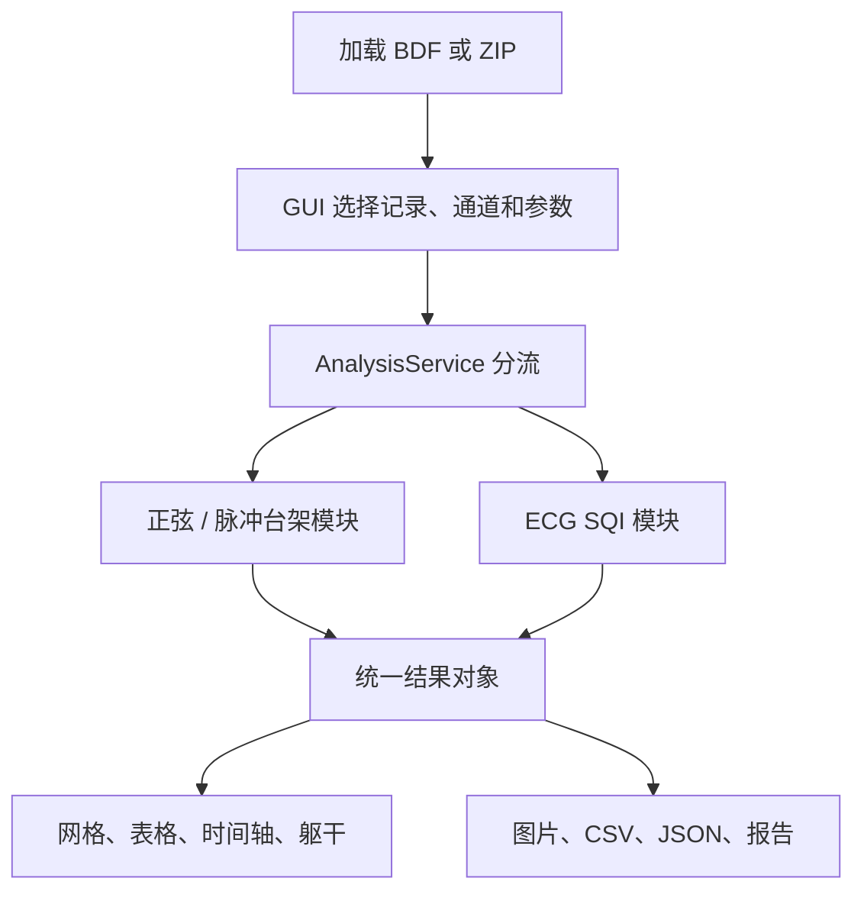

# 从一次点击读懂 electrode-gui

这份讲解面向第一次读整个 GUI 项目的人。先看懂“谁负责什么、数据交给谁”，再打开[逐文件逐行索引](<C:/Users/yuanp/OneDrive/Desktop/BMET/BMET3921/electrode-gui/docs/code-walkthrough/README.md>)。索引覆盖当前的 Python 源码、测试、依赖和 VS Code 配置。

## 1. 你看到的界面，对应哪些代码

| 界面板块 | 对应位置 | 说白了在做什么 |
|---|---|---|
| Analysis workflow | `gui.py` 的 `_build`、`change_profile` | 选择正弦台架、脉冲台架或 ECG；决定后面调用哪套算法 |
| Records and input | `_build_records`、`add_files`、`apply_record` | 加载 BDF/ZIP，记录文件实际输入幅度、频率、波形、接线组、重复组 |
| Channels and analysis | `_build_results`、`choose_channels`、`prepare` | 选择文件中实际存在的通道、同步参考、分析哪些记录及窗口长度 |
| Run analysis | `run`、内部 `worker`、`poll` | 检查输入，交给后台计算，再把结果送回界面 |
| Electrode heatmap | `views/heatmap_view.py` | 把每个通道当前指标的颜色画成圆点，点击圆点查看原因 |
| Results | `gui.py` 的 `redraw`、`select_result` | 用表格显示同一份结果，选择表格行也能查看对应电极 |
| Criteria | `_build_criteria` 和 `config.py` | 编辑“怎样算合格”的参数和阈值 |
| How it works | `_build_help` | 显示帮助文字；这段文字本身不会分析信号 |
| 时间轴 | `views/timeline_view.py` | 切换已经计算完成的时间窗口，例如看 0–10 秒或 10–20 秒 |
| 三维躯干窗口 | `views/torso_window.py`、`torso_view.py`、`torso_geometry.py` | 将已有质量结果放到 A1–D32 的示意位置上，允许旋转、选点和回放 |
| Export | `gui.py` 的 `export`、`utils/report_exporter.py` | 保存当前显示范围的图片/表格，以及完整分析数据和项目设置 |

**界面负责收集和展示，算法负责计算。** 所以一行画按钮的代码通常不含 ECG 公式；真正计算在 `modules`，调度它们的是 `services/analysis_service.py`。



## 2. 程序为什么能出现一个窗口

[gui.py 最后的四行](<C:/Users/yuanp/OneDrive/Desktop/BMET/BMET3921/electrode-gui/gui.py:920>)是默认 F5 启动路径的入口：

```python
if __name__ == '__main__':
    root = tk.Tk()
    ElectrodeQAApp(root)
    root.mainloop()
```

1. 第一行：只有直接运行 `gui.py` 时，才执行下面三行。其他文件 `import gui` 时不会因此自动打开窗口。
2. 第二行：创建最外层窗口，保存为 `root`。
3. 第三行：创建应用对象，执行这个类的 `__init__`；它建立状态变量、按钮、输入框、表格和回调。
4. 第四行：进入事件循环，持续响应点击、键盘输入和定时回调。窗口不是把文件从头执行一遍后就结束。

`main.py` 是另一个入口，增加了命令行选项。例如 `--headless` 让程序不显示窗口，直接分析和导出。两个入口最终使用相同的分析服务，不是两套独立算法。

## 3. class、self 和 def 到底是什么

可以把 `ElectrodeQAApp` 当作“这一整个应用”的类型，把创建出来的对象当作当前运行的这一个应用。

```python
class ElectrodeQAApp:
    def __init__(self, root):
        self.root = root
```

- `class` 定义这一类对象有哪些数据和方法。
- `def` 定义一个方法；定义不等于马上调用它。
- `__init__` 在创建对象时执行，负责初始化。
- `self` 表示当前这个对象。
- `self.root = root` 把外面传进来的窗口保存在对象里，因此其他方法也能使用它。

`self.records` 保存文件清单；`self.channels` 保存所选通道名；`self.settings` 保存阈值和模式；`self.result` 保存本次计算结果。它们解决的是“按钮 A 收到的数据，按钮 B 怎么还能读到”。

## 4. 按钮怎么连接到算法

在 `_build_results` 中：

```python
self.run_button = self.button(bar, 'Run analysis', self.run)
```

`bar` 是放按钮的容器，字符串是按钮上的文字，`self.run` 是将来点击时执行的方法。这里没有括号，表示把函数交给按钮保存；如果写成 `self.run()`，就变成搭界面时立刻执行它。

`self.button` 内部用下面这句创建真正的 Tkinter 按钮：

```python
w = ttk.Button(parent, text=text, command=callback)
```

因此点击之后的顺序是：

| 步骤 | 代码 | 实际作用 |
|---|---|---|
| 1 | `prepare()` | 把输入框中的字符串转成数值，保存当前记录修改，校验通道和参数，固定本次请求 |
| 2 | `invalidate()` | 清除旧结果，防止它被误当成新设置的结果 |
| 3 | `set_busy(True)` | 锁定相关输入，显示正在分析 |
| 4 | `threading.Thread(...).start()` | 在后台运行 `worker`，让主窗口还能响应事件 |
| 5 | `AnalysisService(settings).analyze(...)` | 读取数据，按文件排除设置的尾部时段，再调用对应指标模块 |
| 6 | `self.events.put(('done', result))` | 后台把完成消息和结果放进队列 |
| 7 | `poll()` | 主线程从队列拿出进度、错误或结果 |
| 8 | `accept_result()`、`redraw()` | 保存结果并更新界面 |

后台不会直接修改 Tk 控件。`root.after(80, self.poll)` 的意思是约 80 毫秒之后让事件循环再检查消息，不是每 80 毫秒采集 ECG，也不等于 TCP 实时上传。

## 5. 数据在代码中长什么样

输入有两部分：**采样数组**和**描述实验条件的记录**。

读取器输出 `x`，形状是“采样点数 × 通道数”，物理单位是 µV；`fs` 是每秒采样点数。比如 1000 Hz、10 秒、8 通道的数据，数组有 10000 行、8 列。

| 表达式 | 含义 |
|---|---|
| `x[:, i]` | 所有采样点中的第 i 个通道，i 从 0 开始 |
| `x[left:right]` | 取从 left 到 right 之前的所有通道样本 |
| `left / fs` | 把窗口起始样本编号换成秒 |
| `np.arange(len(x)) / fs` | 给每个采样点生成相对记录起点的时间 |
| `record.input_mVpp` | 该次实验实际输入的峰峰值，单位 mV |
| `record.input_confirmed` | 该输入值是否已确认，不能只凭文件名推断为已校准 |

结果的数据格式集中在 [models.py 的逐行说明](<C:/Users/yuanp/OneDrive/Desktop/BMET/BMET3921/electrode-gui/docs/code-walkthrough/models.py.md>)：

- `MetricResult`：一个指标的颜色、原因和数值。
- `InputRecord`：一份文件的路径及实验条件。
- `RunResult`：一份记录的通道结果、采样率、原始时长、保留时长和排除时长。
- `ElectrodeResult`：一个电极的各项结果。
- `AnalysisResult`：这次运行的全部电极、记录、窗口及设置。

例如 `MetricResult('yellow', 'Actual input Vpp is unconfirmed', values)` 既保存黄色，也保存“为什么黄色”和测量值。界面读取 `color` 画点，读取 `message` 显示解释，导出器读取 `values` 写表。

## 6. 台架阶段：每个计算模块的实验意义

### 幅度：gain_error.py 和 sine_fitter.py

正弦拟合先把测量信号表示为：

`y(t) ≈ a·sin(2πft) + b·cos(2πft) + DC + slope·t`

正弦的峰值幅度是 `sqrt(a²+b²)`，峰峰值是它的两倍。数据原来是 µV，所以换成 mV 要再除以 1000。`DC` 和线性漂移单独拟合，避免它们直接变成基频幅度。

随后 `gain_error.py` 计算：

```python
error = 100 * (measured / record.input_mVpp - 1)
```

实际输入为 100 mVpp、测到 98 mVpp，误差就是 −2%。这是“幅度有没有测准”。输入未确认时不能据此判绿色；波形不可靠时也先返回相应状态。

### SNR、THD、SINAD：bench_spectrum.py

代码把能量拆成基频功率 `P1`、拟合的 2 到 N 次谐波功率 `Ph`，以及去掉拟合分量后、指定带宽内的残差功率 `Pn`：

| 指标 | 当前代码的公式 | 所问的问题 |
|---|---|---|
| SNR | `10 log10(P1 / Pn)` | 排除拟合的指定谐波后，残差噪声有多强？ |
| THD | `100 sqrt(Ph / P1)`，单位 % | 指定谐波总量相对基频有多大？ |
| SINAD | `10 log10(P1 / (Pn + Ph))` | 把噪声与这些谐波失真都算进去，信号有多干净？ |

所以你问“谐波难道不是 noise 吗”：在这里，谐波同样是不想要的成分，但代码为了分别定位问题，把谐波失真与残差噪声分开统计。这里的 SNR 分母不包含已拟合的那些谐波，SINAD 的分母包含。超过拟合阶数或未被模型解释的成分仍可能留在残差里，不能把残差理解成纯随机噪声。

**SNR 高不能代替幅度准确。** 一条很干净却只有预期一半幅度的正弦，仍可能有很高的 SNR。当前代码所以保留独立的 Gain error。

### 同步：time_synchronization.py

这个模块找上升和下降两个方向的过零点。相邻两个样本跨过零点时，用线性插值估计交点：

`t_cross = (i − y[i] / (y[i+1] − y[i])) / fs`

先按方向与参考通道一对一匹配，再计算 `待测时刻 − 参考时刻`。正值表示待测通道较晚。代码统计延迟中位数、绝对延迟 P95 和延迟标准差 jitter；还会记录漏事件、多事件和匹配不足。

这是相对通道的事件时间比较，不能单靠参考自己与自己一致来证明整个系统同步。插值也不自动等同于已经验证了亚采样间隔的硬件精度。

### 线性和重复性：linearity.py、repeatability.py

Linearity 要求多个确认过的输入幅度等级，当前至少三个不同等级。它拟合输入与输出的直线，检查最大偏差相对输入跨度有多大。不能从单一输入强度下的一条波形证明线性。

Repetition 使用人工填写的 `repeat_group`，比较相同接线、频率和名义输入的独立记录。幅度方面计算 CV，即 `标准差 / 平均值 × 100%`；时间方面比较各次运行的延迟中位数是否稳定。实际输入全部确认时比较增益，否则比较输出幅度并注明它也包含信号源与实验装置的变化。当前默认至少三次独立记录，一份文件中重复的正弦周期不算三次实验。

脉冲模式另外使用 `pulse_analyzer.py` 求高低平台差和中点事件；正弦的拟合与 THD 不直接套给脉冲。

## 7. ECG 阶段：ecg_quality.py 的顺序

先检查窗口是否完整、数据是否有限、采样率是否满足当前算法要求，再查平线与削顶，随后计算各个 SQI：

| 分项 | 当前实现 | 结果怎么理解 |
|---|---|---|
| bSQI | 两个不同 QRS 检测器，在容许时间差内一对一匹配；`matched / (count_A + count_B − matched)` | 两个检测器发现的心搏有多一致；一致本身不保证一定检测对了 |
| pSQI | Welch 频谱的 `P[5,15) / P[5,40)` | 分析带宽内有多少功率集中在设定的 QRS 相关频带 |
| kSQI | `kurtosis(x, fisher=False, bias=False)` | 使用 Pearson 峰度及偏差修正；不是减去 3 后的 excess kurtosis |
| basSQI | `1 − P[0,1) / P[0,40)` | 越大表示该定义下的低频基线成分占比越小 |
| integrity | 最长近似平线时间及数字上下限处样本数 | 查持续无变化和削顶；当前没有单独的统一 fSQI 百分数 |

`[5,15)` 表示含 5 Hz、不含 15 Hz。代码先去常数均值，再估计功率；并没有先把所有低频漂移过滤掉，再拿剩下的数据证明没有漂移。

每项得到一个 `MetricResult`。最后 `combine` 按当前分项中最差颜色汇总：红优先于黄，黄优先于绿。**这里不是把 bSQI、pSQI、kSQI、basSQI 相加平均。** 不同 SQI 的定义、范围和单位不同，不能直接随意求平均。

你原本“每个指标独立实现，然后让 GUI 按需调用”的思路，已经体现为指标类/方法与分析服务分离。目前多个 ECG 分项仍集中在同一个文件，不是每个分项各有一个独立文件。

## 8. 两种“时间”和三种“范围”不要混淆

程序里存在采样点的时间 `sample_index / fs`，也存在界面播放下一窗口的定时器。前者用于信号分析，后者只是控制显示速度。

- 窗口结果：这一个时间段里怎么样？
- 单记录结果：这一个文件里怎么样？ECG 的单记录汇总来自其窗口结果；台架还直接计算整段结果。
- 整批结果：全部已分析文件中最差情况是什么？跨记录的线性和重复性也在这里体现。

选不同范围会改变颜色。`record_electrodes`、`window_electrodes` 专门从完整结果取出对应范围，避免一个文件的故障污染另一个文件的显示。线性和独立重复性不能在单个窗口里单独判定。

当前还有 `Exclude final (s)`：默认对每份文件排除最后 1 秒，之后才做所有测量和分窗。比如原始 21 秒、排除 1 秒，实际分析的是 0–20 秒；原始 BDF 不变。这里“整段结果”指保留的整个区间。一个原来刚好 10 秒的文件按默认设置只剩 9 秒，因此不能生成完整的 10 秒 ECG 窗口。设置为 0 可关闭排除。

`config.py` 当前 THD 默认限值是 1%，频率误差默认限值是 0.1%。这些是可修改的项目设置；留空时对应未设置验收阈值。旧版项目中的空默认值会按迁移逻辑采用新默认值，新版项目明确保存的空值则继续保留。

## 9. CT 和实时采集现在处于哪里

当前项目没有 TCP 接收器：BDF/ZIP 是输入，完整窗口是计算对象。若以后接 ActiView 实时流，需要新增接收、解码、缓存和流式窗口调度，再复用合适的指标接口；现有完整窗口/双向滤波不能直接当成已验证的实时处理。

当前三维躯干只做显示，坐标来自 `torso_geometry.py` 的数学示意模型，不是 CT 图像、分割结果或 ECGI 重建。CT 环境影响的实验功能应该围绕“有/无 CT 扫描时，ECG 质量怎样改变”的带标签数据及配对结果建立；目前源码没有这套 CT-on/off 对比流程。

## 10. 如何逐行读，不会在 900 多行 GUI 里迷路

先打开[逐行索引](<C:/Users/yuanp/OneDrive/Desktop/BMET/BMET3921/electrode-gui/docs/code-walkthrough/README.md>)，选一个文件。每份说明先列函数地图，再用“原行号 / 原始代码 / 中文说明”对照。函数地图里的链接可以定位源码起始行。

第一轮按 `gui.py` 最后四行 → `__init__` → `run` → `AnalysisService.analyze` → `gain_error.py` 读，先走通一个完整流程。第二轮换成同步、频谱和 ECG。布局中的 `pack`、`grid`、颜色和间距放在最后读，避免把大部分精力先花在控件排版上。

VS Code 配置在 `.vscode` 中，它们规定启动哪个文件和怎么发现测试；`tests` 负责用已知输入检查行为；`output` 是已有运行产物，`__pycache__` 是自动缓存。这些各有用途，不要把它们都当成主算法。
